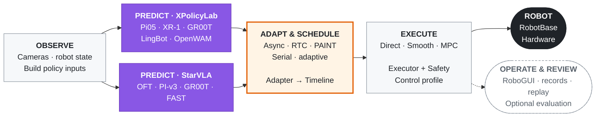

<div align="center">

<p><a href="https://sii-liulab.github.io/manimux/"></a></p>

### Real robot experiments. One inference harness.

An open-source harness for real-world manipulation inference and experiment management.

**[Website](https://sii-liulab.github.io/manimux/)** · **[Documentation](https://sii-liulab.github.io/manimux/guideline.html)** · **[Quick start](#quick-start)** · **[Demo](https://sii-liulab.github.io/manimux/#recordings)**

[](pyproject.toml)
[](LICENSE)

</div>

ManiMux connects policy serving, robot execution, and experiment records through
one workflow. Use **RoboGUI** to inspect camera views and robot state, run supported
policy configurations, and review trajectories and human evaluations.

## RoboGUI


[▶ Watch the real-robot demo](assets/manimux_2026-09-05_23-17-35-00.00.03.144-00.00.34.914-seg1-00.00.02.596-00.00.34.966.mp4)

**Prepare Run / Prepare Experiment → Activate Warmup → Start → Finish → Score.**
Warmup is shown when configured. Free runs need no scoring; experiments read their
score options from the task YAML’s inline `evaluation` rules. Recorded trajectories replay
in a separate, hardware-free view. [Research workflow →](https://sii-liulab.github.io/manimux/guideline.html#experiments)

## News

- **2026-10-18** — Launched the [ManiMux website](https://sii-liulab.github.io/manimux/), with the [guide](https://sii-liulab.github.io/manimux/guideline.html) available as a dedicated subpage.

## Quick start

### Explore without hardware

Python 3.11 or 3.12 and [uv](https://docs.astral.sh/uv/) are required for these commands:

```bash
git clone https://github.com/SII-LiuLab/manimux.git
cd manimux
uv sync --dev
uv run manimux-robogui --robot yam --demo --host 127.0.0.1 --port 8086
```

Open **http://127.0.0.1:8086**. This demo displays synthetic data and the bundled YAM
model; it does not connect to a robot. Model-framework submodules and checkpoints are
only needed for the deployment path you choose.

Try the new arms in RoboGUI using the same environment:

```bash
uv run manimux-robogui --robot piper --demo --host 127.0.0.1 --port 8087
```

Open **http://127.0.0.1:8087**. Use `--robot aloha` for ALOHA-AgileX.
Both presets animate arms and grippers with synthetic data; no device SDK is needed.
ARX X5 currently has a kinematic model and experimental controller, without a
bundled RoboGUI mesh preset.

Upgrading an existing checkout? See the [RoboGUI interface migration](https://sii-liulab.github.io/manimux/guideline.html#launch).

### Run on your robot

1. Select a [model/robot runbook](https://sii-liulab.github.io/manimux/guideline.html#support)
   and prepare its hardware and model environments.
2. Bind devices, service addresses and checkpoint paths in your private
   [station file](.agents/skills/manimux-station-setup/references/station.md).
3. Start the camera, RoboGUI, model server and runtime using the
   [complete Pi05/YAM example](https://sii-liulab.github.io/manimux/guideline.html#launch)
   or the selected model's runbook.
4. Continue in RoboGUI: select the configured task/method, prepare and run trials,
   then review records. For your own task/study, start with the
   [experiment skill](.agents/skills/manimux-experiments/SKILL.md).

`manimux serve` keeps the service available for repeated GUI-driven rollouts.
`manimux run` executes one rollout. Preparation can connect and move the selected robot
as configured; use the runbook matching your actual setup.

[Configuration explained](manimux/configs/README.md) · [Current study and launch commands](https://sii-liulab.github.io/manimux/guideline.html#latest300ep-launch)

## Included integrations

| Component | Included integrations |
| --- | --- |
| Policies with robot deployment recipes | Pi05, DP, SAPolicy, ABC-DiT, GR00T N1.7, LingBot-VLA2, Xiaomi XR-1, UMI DP, OpenWAM |
| Policies with offline recipes | Isaac 0.5; StarVLA: QwenOFT, QwenPI-v3, QwenGR00T, QwenFast |
| Inference modes | Serial, async chunking, RTC, ACT temporal ensembling, AAC, PAINT, AutoHorizon, BID backward-only |
| Hardware | YAM, Tianji–TacCap; experimental ARX X5 and PiPER |
| Executors | Direct, Smooth, MPC |

[ALOHA-AgileX follower-arm assets](.agents/skills/manimux-station-setup/references/aloha.md) and
[standard PiPER assets](.agents/skills/manimux-station-setup/references/piper.md) are available for offline RoboGUI
preview and replay. Experimental [ARX X5 / PiPER SDK adapters](.agents/skills/manimux-station-setup/references/can-arms.md)
include station templates and offline validation; physical deployment remains unvalidated.
The [SDK installation guide](.agents/skills/manimux-station-setup/references/robot-sdks.md) covers their external dependencies.

Policy serving uses **XPolicyLab** or **StarVLA**. These entries describe individual integrations;
compatibility and hardware validation vary by model, method, and robot.
See the [support catalog](https://sii-liulab.github.io/manimux/guideline.html#support) for scope and recipes.
Evaluation is optional; choose your own research protocol and metrics.

## Architecture

Model frameworks own inference. ManiMux owns observation/action adaptation, scheduling,
execution and experiment operation. Strategies decide when to request and hand off chunks;
executors turn timeline references into commands.



XPolicyLab and StarVLA have independent serving environments and ManiMux clients.
A new framework can implement the same client interface. A new robot implements component
and assembly protocols. [Extension map →](.agents/skills/manimux-development/references/README.md)

## Inference strategies and combinations

Choose a supported base algorithm, request schedule, and optional ACT fusion.
Available combinations reuse the configured backend’s sampling hooks; specialized
methods require compatible model-side implementations.

| Purpose | Modes | Behavior |
| --- | --- | --- |
| Execution scheduling | Serial, asynchronous chunking | Infer after the selected prefix finishes, or overlap inference with execution |
| Consistency between chunks | RTC, PAINT, ACT temporal ensembling, BID backward-only | Guide sampling, adjust initial noise, average aligned predictions, or select a coherent candidate |
| Adaptive execution length | AAC, AutoHorizon | Select a source prefix using candidate uncertainty/motion or action attention |

<details>
<summary>Runtime scheduling combinations</summary>

The table below describes runtime scheduling combinations. Model-side support still
depends on the policy backend and required sampling hooks; check the
[model support matrix](.agents/skills/manimux-inference/references/inference-matrix.md)
before selecting a combination:

| Base algorithm | Serial | Async `single_inflight` | Async `multi_inflight` | Optional ACT fusion |
| --- | --- | --- | --- | --- |
| Ordinary chunking (`serial` / `async`) | Yes | Yes | Yes | Select `act_temporal_ensemble` |
| ACT temporal ensembling | Yes | Yes | Yes | Already enabled |
| RTC | — | Yes | Yes | Yes |
| PAINT | — | Yes | Yes | Yes |
| BID backward-only | Yes | Yes | Yes | Yes |
| AAC | Yes | Yes | Yes | Yes |
| AutoHorizon | Yes | Yes | Yes | Yes |

</details>

BID also supports AAC adaptive horizons, with optional ACT fusion. For deadline
aliases, decoding requirements and YAML examples, use the [inference guide](https://sii-liulab.github.io/manimux/guideline.html#algorithms)
and [supported combinations](https://sii-liulab.github.io/manimux/guideline.html#optional-algorithm-composition).

## Run an experiment campaign

A collection organizes tasks, methods, trial counts and a recording root. RoboGUI
exposes **Task → Method / Config → Layout**; compatible entries switch while idle.
Task files define instructions, layouts and scoring. Each trial records its resolved
settings, trajectories and optional human assessment for reproducible comparisons.

The [published Pi05 study](manimux/configs/collections/pi05-latest300ep-step30000.yaml)
illustrates five tasks and six inference methods, with additional starting-pose variants.
Use it as a concrete example; choose task rules, checkpoints and comparison settings
for your own study. Offline reports combine human scores, motion metrics and optional
PRM assessments. Runtime completion and task success are distinct.

[Experiment workflow](https://sii-liulab.github.io/manimux/guideline.html#experiments) ·
[Launch commands](https://sii-liulab.github.io/manimux/guideline.html#latest300ep-launch) ·
[Recording protocol](https://sii-liulab.github.io/manimux/guideline.html#study-storage-protocol) ·
[Evaluation and reports](https://sii-liulab.github.io/manimux/guideline.html#reports)

## Integrate

**For users:** configure an existing combination and use RoboGUI.
**For your coding agent:** use the [development skill](.agents/skills/manimux-development/SKILL.md)
or the matching task skill below. If your tool does not discover repository skills,
ask it to read the linked `SKILL.md` explicitly.

| Task | Entry point |
| --- | --- |
| Add a robot, gripper or camera | [Component protocols](.agents/skills/manimux-development/references/components.md) |
| Add a model, framework or action adapter | [Policy protocols](.agents/skills/manimux-development/references/policies.md) |
| Add scheduling, execution or a GUI feature | [Runtime protocols](.agents/skills/manimux-development/references/runtime-config.md) |
| Connect supported hardware at another lab | [Station setup skill](.agents/skills/manimux-station-setup/SKILL.md) |
| Build a custom study, collect trials or evaluate recordings | [Experiment skill](.agents/skills/manimux-experiments/SKILL.md) |

Each integration documents its input/output semantics, owning files, YAML selection and
validation.

**Build with us.** Contributions are welcome—from new embodiments, policies, and
inference strategies to documentation and bug fixes. Start with the
[integration guide](.agents/skills/manimux-development/references/README.md), follow the shared protocols, and see
[Contributing](.agents/skills/manimux-development/references/README.md#contributing) for the expected handoff.

## Documentation map

| Entry | Purpose |
| --- | --- |
| This README | Project scope, architecture, supported integrations and getting started |
| Directory READMEs, such as [configs](manimux/configs/README.md) | Local file organization, module responsibilities and links to detailed guidance |
| [User guide](https://sii-liulab.github.io/manimux/guideline.html) | Setup, parameter explanations, commands and complete experiment workflows |
| [Agent skills](.agents/skills/manimux-development/SKILL.md) | What an agent should inspect, ask, implement and verify for a specific task |

## Support and evidence

See the [support catalog](https://sii-liulab.github.io/manimux/guideline.html#support) for model, hardware and method
runbooks. Capabilities vary by checkpoint and backend; an integration does not imply
that every model × robot × algorithm combination has been tested on hardware.
ManiMux is under active development. Each deployment guide states its validation scope.

## Citation

If ManiMux supports your research, please cite the repository below. A paper link
will be added when available:

**ManiMux: An open-source harness for real-world manipulation inference and experiment management**

```bibtex
@misc{manimux2026,
  title = {{ManiMux}: An Open-Source Harness for Real-World Manipulation Inference and Experiment Management},
  year = {2026},
  howpublished = {GitHub repository},
  url = {https://github.com/SII-LiuLab/manimux}
}
```

Please also cite the components, models and methods used in your work:
[XPolicyLab](https://github.com/XPolicyLab/XPolicyLab), [StarVLA](https://github.com/starVLA/starVLA) and [PRM-as-a-Judge](https://github.com/YuyangLiu2003/PRM-as-a-Judge).

<details>
<summary>Official BibTeX for related projects (cite those you use)</summary>

[XPolicyLab](https://arxiv.org/abs/2608.09892)

```bibtex
@article{community2026xpolicylab,
  title={{XPolicyLab}: A Unified Standard and Open Ecosystem for Robot Policy Evaluation and Deployment},
  author={Community, XPolicyLab and Chen, Tianxing and Chen, Yue and Nian, Tian and Cai, Zijian and Chen, Guangyu and Lin, Wenwei and Liang, Qiwei and Xiang, Peicheng and Su, Kailun and others},
  journal={arXiv preprint arXiv:2608.09892},
  year={2026}
}
```

[StarVLA](https://arxiv.org/abs/2604.05014)

```bibtex
@article{community2026starvla,
  title={StarVLA: A Lego-like Codebase for Vision-Language-Action Model Developing},
  author={Community, StarVLA},
  journal={arXiv preprint arXiv:2604.05014},
  year={2026},
  eprint={2604.05014},
  archivePrefix={arXiv},
  primaryClass={cs.RO}
}
```

[PRM-as-a-Judge 1.5 — toolkit report](https://arxiv.org/pdf/2608.14284)

```bibtex
@article{liu2026prmjudge15,
  title   = {PRM-as-a-Judge 1.5: A Toolkit for Robot Process Assessment},
  author  = {Liu, Yuyang and Shen, Yanqing and Chen, Ruike and Zhao, Jifan and Tian, Yuxuan and Zhang, Yichi and Long, Tianfeng and Yin, Zixuan and Wang, Yipu and Qin, Ziheng and Tan, Wenxing and Shi, Yang and Cao, Mingyu and Xiao, Runze and Wang, Ziqi and Yin, Zhixin and Chu, Shiwei and Zhang, Yi-Fan and Mu, Yao and Ji, Yuheng and Wang, Yihao and Yan, Jun and Wang, Zhongyuan and Wang, Pengwei and Zheng, Xiaolong},
  journal = {arXiv preprint arXiv:2608.14284},
  year    = {2026},
  url     = {https://arxiv.org/pdf/2608.14284}
}
```

[PRM-as-a-Judge — original method](https://arxiv.org/abs/2603.21669)

```bibtex
@article{ji2026prmjudge,
  title   = {PRM-as-a-Judge: A Dense Evaluation Paradigm for Fine-Grained Robotic Auditing},
  author  = {Ji, Yuheng and Liu, Yuyang and Tan, Huajie and Huang, Xuchuan and Huang, Fanding and Xu, Yijie and Chi, Cheng and Zhao, Yuting and Lyu, Huaihai and Co, Peterson and others},
  journal = {arXiv preprint arXiv:2603.21669},
  year    = {2026}
}
```

</details>

[Third-party notices](licenses/THIRD_PARTY_NOTICES.md) · [Upstream licenses](licenses) · [Documentation](https://sii-liulab.github.io/manimux/guideline.html)

## License

ManiMux is licensed under [MIT](LICENSE). Third-party frameworks, SDKs and assets
retain their own licenses; see [third-party notices](licenses/THIRD_PARTY_NOTICES.md).
